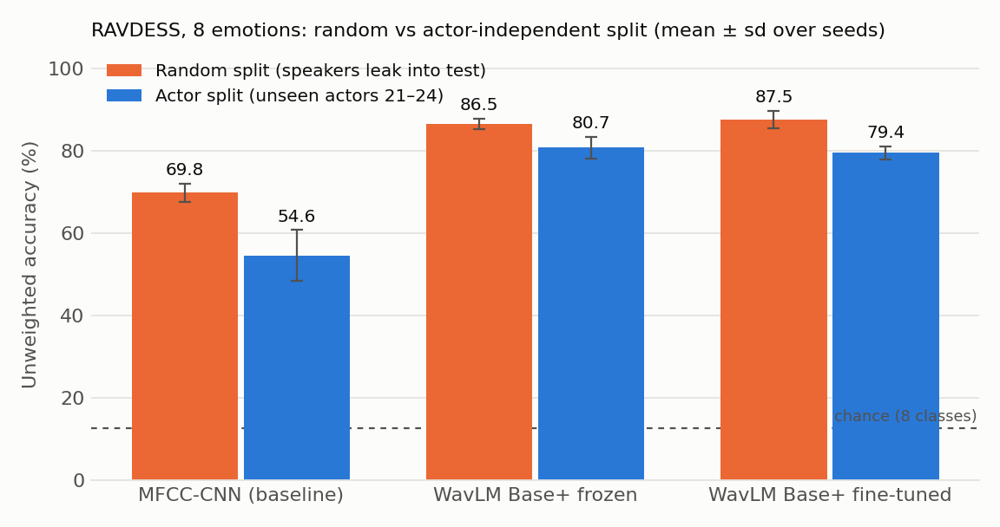
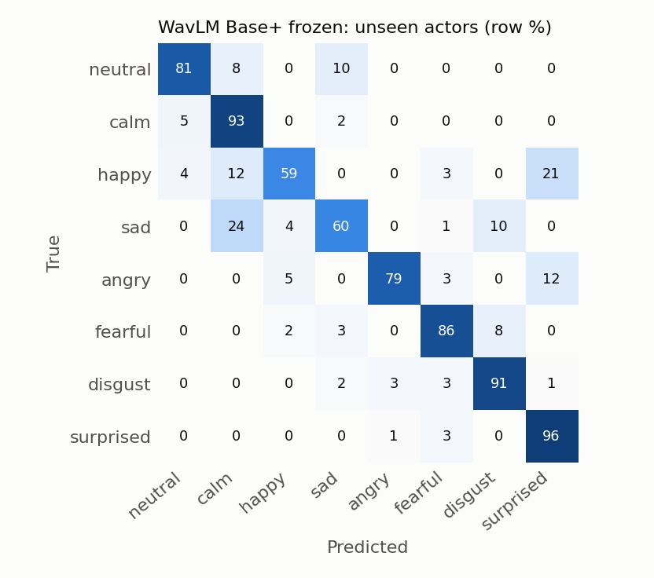

# Speech Emotion Recognition on RAVDESS, tested on unseen actors

> **A model that recognises 8 emotions from voice, tested only on actors it never heard.**

Many RAVDESS projects report 90%+ accuracy using a *random* train/test split. That split puts the same 24 actors,
and near-identical takes of the same sentence, on both sides, so the model can partly recognise the *speaker*
rather than the emotion. This project reports both numbers side by side:

* **Actor-independent split** (headline): train on actors 1–18, select models on actors 19–20, test once on actors 21–24.
* **Random split** (for comparison): a stratified random split with exactly the same sizes (1080 / 120 / 240 clips).

The gap between the two is the size of the speaker leakage.

<!-- RESULTS:START -->
## Results

Unweighted accuracy (UA = mean per-class recall) on RAVDESS, 8 emotions, mean ± sd over 3 seeds.
Every test set is scored once, with the checkpoint chosen on validation UA.

| Model | Random split UA | **Actor split UA (unseen actors)** | Gap |
|---|---|---|---|
| MFCC-CNN baseline | 69.8 ± 2.2 | **54.6 ± 6.1** | 15.2 pp |
| WavLM Base+ frozen + layer-weighted head | 86.5 ± 1.3 | **80.7 ± 2.6** | 5.7 pp |
| WavLM Base+ fine-tuned | 87.5 ± 2.2 | **79.4 ± 1.6** | 8.1 pp |



The same pipeline reports **87.5%** when speakers are allowed to leak across a random split, and **79.4%** when
they are not. That 8-point drop is the part most RAVDESS write-ups never show, and it is larger still for the
MFCC-CNN (15 points), which leans more heavily on speaker identity.

Two honest observations:

* **Fine-tuning did not beat the frozen encoder on RAVDESS** (79.4 vs 80.7, well within seed noise). With 1,080
  training clips there is little for 94M parameters to learn. The first fine-tuning attempt was far worse
  (56.6%) until the learning rate was lowered and a head-only warm-up added — chosen on validation only,
  see [docs/finetune_search.md](docs/finetune_search.md).
* **Fine-tuning did help where it matters for generalisation**: on unseen CREMA-D speakers it scores 44.4%
  against the frozen model's 30.6%.

### Confusion on unseen actors (row %, pooled over seeds)



Errors are not random: *happy* is confused with *surprised*, *sad* with *calm*. Neutral and calm — the pair
RAVDESS itself distinguishes only by intensity — account for much of the remaining loss.

### Cross-corpus (the harder test)

Only the 6 emotions both corpora share are scored; chance is 16.7%.

| Trained on | Model | In-corpus test | Cross-corpus test |
|---|---|---|---|
| RAVDESS actors 1–18 | frozen | 80.7 (8-class, unseen actors) | 30.6 on CREMA-D |
| RAVDESS actors 1–18 | fine-tuned | 79.4 (8-class, unseen actors) | **44.4** on CREMA-D |
| CREMA-D, 64 speakers | frozen | **75.0** (6-class, 18 unseen speakers) | 48.8 on RAVDESS |
| CREMA-D, 64 speakers | fine-tuned | 73.0 (6-class, 18 unseen speakers) | 47.7 on RAVDESS |

A model trained on 64 CREMA-D speakers reaches 75.0% on 18 speakers it never heard, but only ~49% on RAVDESS.
Acted RAVDESS emotion and crowd-sourced CREMA-D emotion are not the same distribution, and neither is a
solved problem.

Full tables, per-class recalls and every confusion matrix: [results/RESULTS.md](results/RESULTS.md).

**Resume bullet, with the numbers actually measured:** Fine-tuned WavLM Base+ for 8-class speech emotion
recognition on RAVDESS, reaching 79.4% unweighted accuracy on four unseen actors (80.7% with a frozen
encoder) versus 54.6% for an MFCC-CNN baseline; demonstrated that a random split inflates the same pipeline
to 87.5% through speaker leakage, and reported cross-corpus transfer to CREMA-D. Deployed a live Gradio demo.
<!-- RESULTS:END -->

## What is in here

| Path | What it does |
|---|---|
| `ser/data.py` | Downloads RAVDESS (Zenodo) and CREMA-D (official GitHub LFS), parses labels, builds the splits, loads audio (16 kHz mono, silence-trimmed, peak-normalised) |
| `ser/models.py` | MFCC-CNN baseline; WavLM Base+ classifier with a SUPERB-style learnable weighting of all 13 layers, mean pooling and a 2-layer MLP |
| `ser/train.py` | Training loops (early stopping / checkpoint choice on **validation** UA only), metrics |
| `scripts/run_experiments.py` | Runs every experiment, one JSON per run in `results/runs/`, resumable |
| `scripts/make_report.py` | Tables (`results/RESULTS.md`, `results/summary.json`) and figures (`results/figures/`) |
| `notebooks/train_colab.ipynb` | Self-contained Colab notebook (built by `tools/build_colab_notebook.py`) that produced the results |
| `app/app.py` | Gradio demo: record your voice, get an emotion distribution |
| `tools/export_space.py` | Assembles a ready-to-upload Hugging Face Space in `space/` |

## Method

**Data.** RAVDESS speech: 1,440 clips, 24 professional actors (12 female, 12 male), 2 sentences
("Kids are talking by the door", "Dogs are sitting by the door"), 8 emotions: neutral, calm, happy, sad, angry,
fearful, disgust, surprised. Neutral has half as many clips as the other classes (96 vs 192). This is why
**unweighted accuracy (UA, the mean of per-class recalls)** is the headline metric, and all losses are class-weighted.

**Splits.** Actor split: 1–18 / 19–20 / 21–24 (each part is gender-balanced). Random split: stratified by emotion,
fixed seed, identical sizes. The test set is scored exactly once per run, with the checkpoint chosen on validation UA.
**No hyper-parameter was tuned on test data.** The CNN and frozen models used their hyper-parameters as fixed
up front; the fine-tuning ones were chosen after the first attempt underperformed, by comparing four
configurations on the validation actors alone ([docs/finetune_search.md](docs/finetune_search.md)).

**Models.**

1. *MFCC-CNN baseline*: 40 MFCCs + Δ + ΔΔ (25 ms window, 10 ms hop), 3.5 s crops, 4 double-conv blocks
   (32–64–128–128 channels), mean+max temporal pooling. SpecAugment-style masking, AdamW, cosine LR, up to 60 epochs.
2. *WavLM Base+, frozen*: `microsoft/wavlm-base-plus` is frozen. Each of its 13 hidden layers is mean-pooled over
   time, layer-normalised and mixed with learnable softmax weights (as in the SUPERB benchmark), followed by a
   768→256→8 MLP. Because pooling is linear, the per-layer means are cached once and the head trains in seconds.
3. *WavLM Base+, fine-tuned*: the same model, with the transformer fine-tuned end to end (the convolutional
   waveform encoder stays frozen). The classifier head trains alone for 3 epochs, then the encoder unfreezes at
   LR 3e-5 (head LR 1e-3) for 9 more; 10% warm-up then linear decay, batch 8, fp16, and WavLM's built-in time
   masking. LayerDrop is disabled, otherwise the number of hidden layers varies between training and evaluation.

Each configuration is run with 3 seeds; tables report mean ± standard deviation.

**Cross-corpus test.** RAVDESS has only 2 sentences, so it is easy to overfit. As an extra check, the notebook
downloads **CREMA-D** (7,442 clips, 91 actors, 12 sentences, 6 emotions) and splits it by speaker (64 train / 9 val /
18 test). Then it (a) scores the RAVDESS-trained models on the 18 unseen CREMA-D speakers and (b) trains WavLM on
CREMA-D and scores it on all 24 RAVDESS actors. Only the 6 emotions the corpora share are scored.

## Reproduce

GPU (what produced the numbers above): open `notebooks/train_colab.ipynb` in Google Colab, select a T4 GPU and run
all cells. The full run takes about 2–3 hours on a free T4.

Locally:

```bash
pip install -r requirements.txt
python scripts/run_experiments.py                      # all stages; add --no-cremad to skip CREMA-D
python scripts/make_report.py                          # tables + figures from results/runs/*.json
python scripts/run_experiments.py --quick --out results_quick   # 5-minute smoke test on CPU
```

## Demo (Gradio / Hugging Face Spaces)

```bash
python app/app.py              # local demo at http://127.0.0.1:7860
```

The demo loads `results/checkpoints/wavlm_frozen_head.pt`: a 0.8 MB classifier head on top of the pretrained
WavLM Base+, trained on actors 1–18 only, scoring **78.9% UA on the unseen test actors**. The frozen model is
both the best of the three on unseen actors and small enough to commit, so the demo needs no large weights —
the encoder is pulled from the Hub at start-up. If `results/checkpoints/wavlm_finetuned.pt` is present (save it
from a training run with `--save-ft-checkpoint`), the demo uses the fine-tuned model instead.

To publish it as a Space (needs a free Hugging Face account and `hf auth login`):

```bash
python tools/export_space.py
hf repo create <your-username>/speech-emotion-recognition --repo-type space --space-sdk gradio
hf upload <your-username>/speech-emotion-recognition space . --repo-type space
```

## Limitations

* RAVDESS is **acted**, North-American English, studio-quality speech with 2 fixed sentences. Accuracy on
  spontaneous speech, other languages or noisy phone microphones will be lower (see the cross-corpus rows).
* With 4 test actors, one actor more or less changes UA by several points, so treat the seed standard deviations
  as a lower bound on the real uncertainty.
* IEMOCAP (the standard benchmark, 4-class leave-one-session-out) needs a licence from USC SAIL and is not included.

## Data and credits

* **RAVDESS**: Livingstone SR, Russo FA (2018). *The Ryerson Audio-Visual Database of Emotional Speech and Song
  (RAVDESS).* PLoS ONE 13(5): e0196391. [doi:10.1371/journal.pone.0196391](https://doi.org/10.1371/journal.pone.0196391).
  Licensed **CC BY-NC-SA 4.0**: non-commercial use with attribution. Audio is downloaded at run time and is not
  redistributed in this repository.
* **CREMA-D**: Cao H, Cooper DG, Keutmann MK, Gur RC, Nenkova A, Verma R (2014). *CREMA-D: Crowd-sourced Emotional
  Multimodal Actors Dataset.* IEEE Trans. Affective Computing 5(4). Open Database License.
* **WavLM**: Chen S. et al. (2022). *WavLM: Large-Scale Self-Supervised Pre-Training for Full Stack Speech
  Processing.* IEEE JSTSP. Weights: `microsoft/wavlm-base-plus`.
* **SUPERB**: Yang S. et al. (2021). *SUPERB: Speech processing Universal PERformance Benchmark.* Interspeech.
