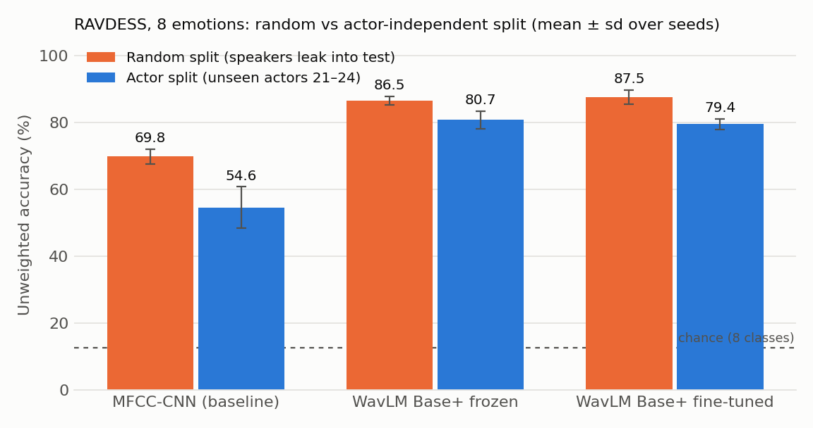
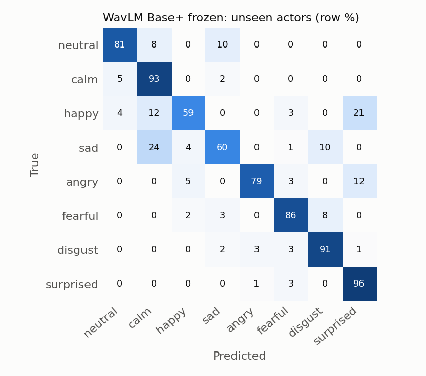

# Speech Emotion Recognition on RAVDESS (unseen actors)

8-class speech emotion recognition on RAVDESS, tested only on actors the model never heard during training.

Abhiram Radhakrishnan

[Open in Colab](https://colab.research.google.com/github/24f1002043/Speech_Emotion_Recognition/blob/main/notebooks/train_colab.ipynb)

Related paper: [Whose Label? Actor Intent Versus Listener Perception in CREMA-D Speech Emotion Recognition](https://github.com/24f1002043/icassp/blob/main/paper/abhiram_icassp2027_preprint.pdf), submitted to IEEE ICASSP 2027 (under review).

Frozen WavLM Base+ gets 80.7% UA on unseen actors, compared to 54.6% for an MFCC-CNN. The same pipeline gets 86.5-87.5% on a random split because of speaker leakage.

To reproduce everything (or use the Colab notebook, about 2-3 h on a free T4):

```bash
pip install -r requirements.txt && python scripts/run_experiments.py && python scripts/make_report.py
```

A lot of RAVDESS projects report 90%+ using a random split. That puts the same 24 actors, and almost identical takes of the same sentence, in both train and test, so the model can partly recognise the speaker instead of the emotion. Both splits are reported here:

- Actor-independent split (main result): train on actors 1-18, validate on 19-20, test once on 21-24.
- Random split (for comparison): stratified, same sizes (1080 / 120 / 240 clips).

The difference between the two is the speaker leakage.

## Results

Unweighted accuracy (UA, mean per-class recall) on RAVDESS, 8 emotions, mean ± sd over 3 seeds. Each test set is scored once using the checkpoint picked on validation UA.

| Model | Random split UA | Actor split UA (unseen actors) | Gap |
|---|---|---|---|
| MFCC-CNN baseline | 69.8 ± 2.2 | 54.6 ± 6.1 | 15.2 pp |
| WavLM Base+ frozen + layer-weighted head | 86.5 ± 1.3 | 80.7 ± 2.6 | 5.7 pp |
| WavLM Base+ fine-tuned | 87.5 ± 2.2 | 79.4 ± 1.6 | 8.1 pp |



The fine-tuned model drops from 87.5% to 79.4% when speakers can't leak. The MFCC-CNN drops 15 points since it relies more on speaker identity.

- Fine-tuning did not beat the frozen encoder on RAVDESS (79.4 vs 80.7, within seed noise). With 1,080 training clips there isn't much for 94M parameters to learn. The first fine-tuning attempt got 56.6% until the learning rate was lowered and a head-only warm-up was added, chosen on validation only (see [docs/finetune_search.md](docs/finetune_search.md)).
- Fine-tuning did help on unseen CREMA-D speakers: 44.4% vs 30.6% for the frozen model.

### Confusion on unseen actors (row %, pooled over seeds)



Happy gets confused with surprised and sad with calm. Neutral vs calm, which RAVDESS only separates by intensity, accounts for a lot of the remaining errors.

### Cross-corpus

Only the 6 emotions shared by both corpora are scored; chance is 16.7%.

| Trained on | Model | In-corpus test | Cross-corpus test |
|---|---|---|---|
| RAVDESS actors 1-18 | frozen | 80.7 (8-class, unseen actors) | 30.6 on CREMA-D |
| RAVDESS actors 1-18 | fine-tuned | 79.4 (8-class, unseen actors) | 44.4 on CREMA-D |
| CREMA-D, 64 speakers | frozen | 75.0 (6-class, 18 unseen speakers) | 48.8 on RAVDESS |
| CREMA-D, 64 speakers | fine-tuned | 73.0 (6-class, 18 unseen speakers) | 47.7 on RAVDESS |

Trained on 64 CREMA-D speakers, the model gets 75.0% on 18 unseen speakers but only about 49% on RAVDESS. Acted RAVDESS and crowd-sourced CREMA-D are different distributions.

Full tables, per-class recall and all confusion matrices are in [results/RESULTS.md](results/RESULTS.md).

## Files

| Path | Description |
|---|---|
| `ser/data.py` | downloads RAVDESS (Zenodo) and CREMA-D (GitHub LFS), parses labels, builds splits, loads audio (16 kHz mono, silence-trimmed, peak-normalised) |
| `ser/models.py` | MFCC-CNN baseline; WavLM Base+ classifier with learnable weights over all 13 layers (SUPERB style), mean pooling and a 2-layer MLP |
| `ser/train.py` | training loops (early stopping and checkpoint choice on validation UA only), metrics |
| `scripts/run_experiments.py` | runs all experiments, one JSON per run in `results/runs/`, resumable |
| `scripts/make_report.py` | tables (`results/RESULTS.md`, `results/summary.json`) and figures (`results/figures/`) |
| `notebooks/train_colab.ipynb` | Colab notebook that produced the results (built by `tools/build_colab_notebook.py`) |
| `app/app.py` | Gradio demo: record your voice and get an emotion distribution |
| `tools/export_space.py` | builds a Hugging Face Space folder in `space/` |

## Method

Data: RAVDESS speech, 1,440 clips, 24 actors (12 female, 12 male), 2 sentences ("Kids are talking by the door", "Dogs are sitting by the door"), 8 emotions: neutral, calm, happy, sad, angry, fearful, disgust, surprised. Neutral has half as many clips (96 vs 192), so UA is the main metric and all losses are class-weighted.

Splits: actor split 1-18 / 19-20 / 21-24 (each part gender-balanced). Random split is stratified by emotion with a fixed seed and the same sizes. The test set is scored once per run with the checkpoint chosen on validation UA. No hyperparameters were tuned on test data. The CNN and frozen models used fixed hyperparameters. The fine-tuning ones were picked after the first attempt underperformed, by comparing four configs on the validation actors only ([docs/finetune_search.md](docs/finetune_search.md)).

Models:

1. MFCC-CNN baseline: 40 MFCCs + delta + delta-delta (25 ms window, 10 ms hop), 3.5 s crops, 4 double-conv blocks (32-64-128-128 channels), mean+max pooling over time. SpecAugment-style masking, AdamW, cosine LR, up to 60 epochs.
2. WavLM Base+ frozen: `microsoft/wavlm-base-plus` is frozen. Each of the 13 hidden layers is mean-pooled over time, layer-normalised and combined with learnable softmax weights (as in SUPERB), then a 768-256-8 MLP. Since pooling is linear, the per-layer means are cached once and the head trains in seconds.
3. WavLM Base+ fine-tuned: same model with the transformer fine-tuned end to end (the conv waveform encoder stays frozen). The head trains alone for 3 epochs, then the encoder is unfrozen at LR 3e-5 (head LR 1e-3) for 9 more epochs. 10% warm-up then linear decay, batch 8, fp16, WavLM's built-in time masking. LayerDrop is turned off, otherwise the number of hidden layers changes between training and evaluation.

Each config is run with 3 seeds; tables show mean ± sd.

Cross-corpus: RAVDESS has only 2 sentences, so it's easy to overfit. The notebook also downloads CREMA-D (7,442 clips, 91 actors, 12 sentences, 6 emotions) and splits it by speaker (64 train / 9 val / 18 test). It then (a) scores the RAVDESS models on the 18 unseen CREMA-D speakers and (b) trains WavLM on CREMA-D and tests on all 24 RAVDESS actors. Only the 6 shared emotions are scored.

## Running

GPU (used for the results above): open `notebooks/train_colab.ipynb` in Colab, pick a T4 GPU and run all cells. Takes about 2-3 hours.

Locally:

```bash
pip install -r requirements.txt
python scripts/run_experiments.py                      # all stages, add --no-cremad to skip CREMA-D
python scripts/make_report.py                          # tables and figures from results/runs/*.json
python scripts/run_experiments.py --quick --out results_quick   # 5 min CPU smoke test
```

## Demo

```bash
python app/app.py              # http://127.0.0.1:7860
```

The demo uses `results/checkpoints/wavlm_frozen_head.pt`, a 0.8 MB head on top of pretrained WavLM Base+, trained on actors 1-18 only. It gets 78.9% UA on the test actors. The frozen model was the best on unseen actors and small enough to commit, so no large weights are needed; the encoder is downloaded from the Hub at startup. If `results/checkpoints/wavlm_finetuned.pt` exists (save it with `--save-ft-checkpoint`), the demo uses the fine-tuned model.

To publish as a Hugging Face Space (needs `hf auth login`):

```bash
python tools/export_space.py
hf repo create <your-username>/speech-emotion-recognition --repo-type space --space-sdk gradio
hf upload <your-username>/speech-emotion-recognition space . --repo-type space
```

## Limitations

- RAVDESS is acted, North American English, studio quality, with 2 fixed sentences. Expect lower accuracy on spontaneous speech, other languages or noisy phone mics (see the cross-corpus results).
- With 4 test actors, one actor can move UA by several points, so the seed sd underestimates the real uncertainty.
- IEMOCAP (4-class, leave-one-session-out) needs a licence from USC SAIL and is not included.

## Data and credits

- RAVDESS: Livingstone SR, Russo FA (2018). The Ryerson Audio-Visual Database of Emotional Speech and Song (RAVDESS). PLoS ONE 13(5): e0196391. [doi:10.1371/journal.pone.0196391](https://doi.org/10.1371/journal.pone.0196391). CC BY-NC-SA 4.0. Audio is downloaded at run time and not included here.
- CREMA-D: Cao H, Cooper DG, Keutmann MK, Gur RC, Nenkova A, Verma R (2014). CREMA-D: Crowd-sourced Emotional Multimodal Actors Dataset. IEEE Trans. Affective Computing 5(4). Open Database License.
- WavLM: Chen S. et al. (2022). WavLM: Large-Scale Self-Supervised Pre-Training for Full Stack Speech Processing. IEEE JSTSP. Weights: `microsoft/wavlm-base-plus`.
- SUPERB: Yang S. et al. (2021). SUPERB: Speech processing Universal PERformance Benchmark. Interspeech.

## License

Code is MIT (see [LICENSE](LICENSE)). Datasets keep their own terms.
