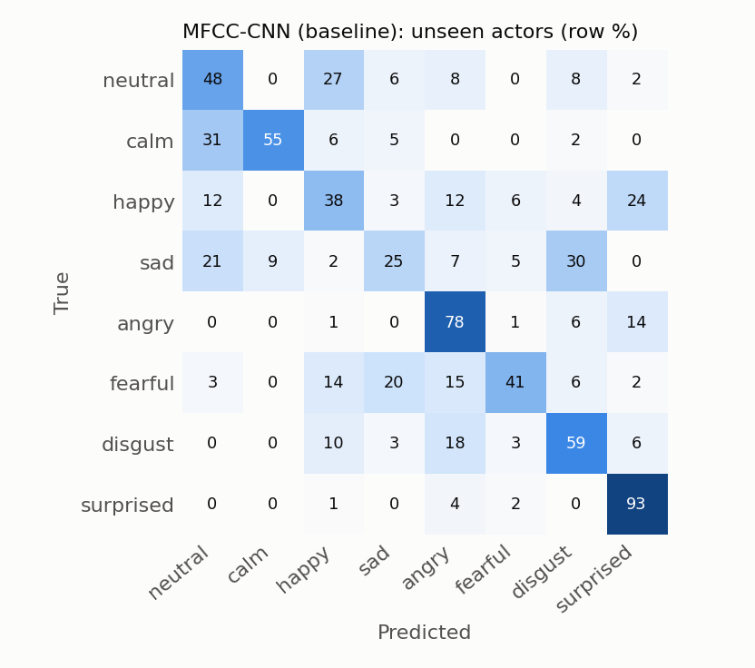
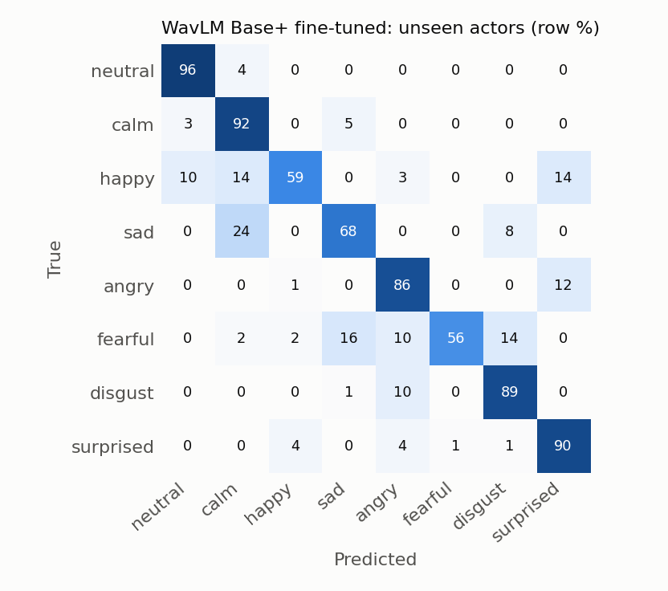

# Results

All numbers are on held-out test data, scored once with the checkpoint picked on validation UA.
UA = unweighted accuracy (mean per-class recall); WA = plain accuracy. Mean ± sd over seeds.

## RAVDESS (8 emotions): random split vs actor-independent split

| Model | Random split UA | Actor split UA (unseen actors) | Gap (pp) | Actor split WA | Actor split macro-F1 | Seeds |
|---|---|---|---|---|---|---|
| MFCC-CNN (baseline) | 69.8 ± 2.2 | **54.6 ± 6.1** | +15.2 | 55.0 ± 5.5 | 52.7 ± 7.0 | 3 |
| WavLM Base+ frozen | 86.5 ± 1.3 | **80.7 ± 2.6** | +5.7 | 80.7 ± 1.7 | 80.3 ± 2.2 | 3 |
| WavLM Base+ fine-tuned | 87.5 ± 2.2 | **79.4 ± 1.6** | +8.1 | 78.3 ± 1.5 | 78.2 ± 1.6 | 3 |

Split sizes (both splits): train 1080 / val 120 / test 240 clips. Actor split: actors 1–18 train, 19–20 val, 21–24 test.

## Per-class recall on unseen actors (actor split, pooled over seeds)

| Model | neutral | calm | happy | sad | angry | fearful | disgust | surprised |
|---|---|---|---|---|---|---|---|---|
| MFCC-CNN (baseline) | 48 | 55 | 38 | 25 | 78 | 41 | 59 | 93 |
| WavLM Base+ frozen | 81 | 93 | 59 | 60 | 79 | 86 | 91 | 96 |
| WavLM Base+ fine-tuned | 96 | 92 | 59 | 68 | 86 | 56 | 89 | 90 |

## Cross-corpus generalisation (RAVDESS ↔ CREMA-D)

Only the 6 emotions both corpora share are scored across corpora (neutral, happy, sad, angry, fearful, disgust); an 8-class RAVDESS model is restricted to those 6 outputs. Chance = 16.7%.

| Model | Trained on | In-corpus test | UA | Cross-corpus test | UA |
|---|---|---|---|---|---|
| MFCC-CNN (baseline) | RAVDESS actors 1–18 | RAVDESS actors 21–24 (8-class) | 54.6 ± 6.1 | CREMA-D, 18 unseen speakers (6-class) | 25.4 ± 0.9 |
| WavLM Base+ frozen | RAVDESS actors 1–18 | RAVDESS actors 21–24 (8-class) | 80.7 ± 2.6 | CREMA-D, 18 unseen speakers (6-class) | 30.6 ± 0.4 |
| WavLM Base+ fine-tuned | RAVDESS actors 1–18 | RAVDESS actors 21–24 (8-class) | 79.4 ± 1.6 | CREMA-D, 18 unseen speakers (6-class) | 44.4 ± 2.3 |
| WavLM Base+ frozen | CREMA-D, 64 speakers | CREMA-D, 18 unseen speakers (6-class) | 75.0 ± 0.9 | RAVDESS, all 24 actors (6-class) | 48.8 ± 1.4 |
| WavLM Base+ fine-tuned | CREMA-D, 64 speakers | CREMA-D, 18 unseen speakers (6-class) | 73.0 | RAVDESS, all 24 actors (6-class) | 47.7 |

## Which WavLM layers matter (frozen model, learned layer weights)

Layer 0 = CNN/embedding output, 12 = last transformer layer. Top layers: 5 (12%), 6 (11%), 4 (11%).
